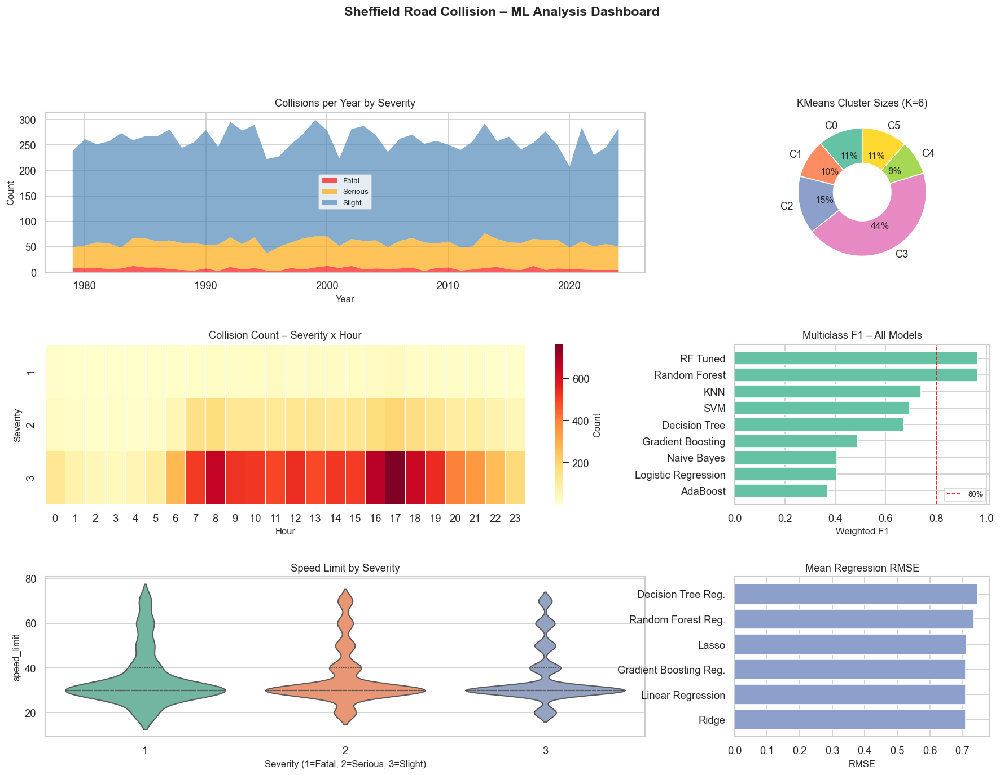
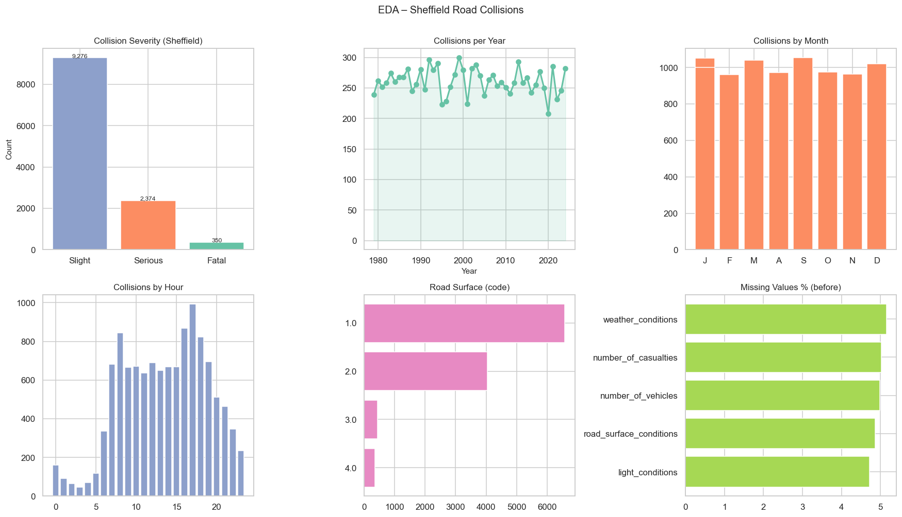
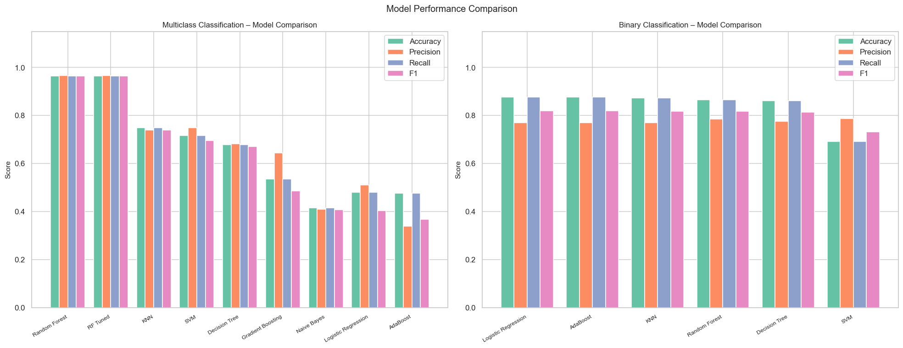
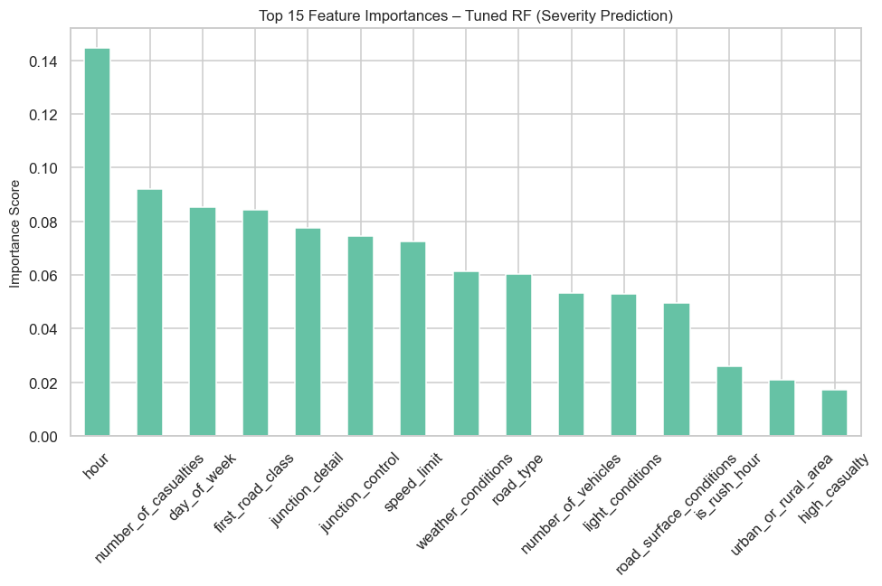
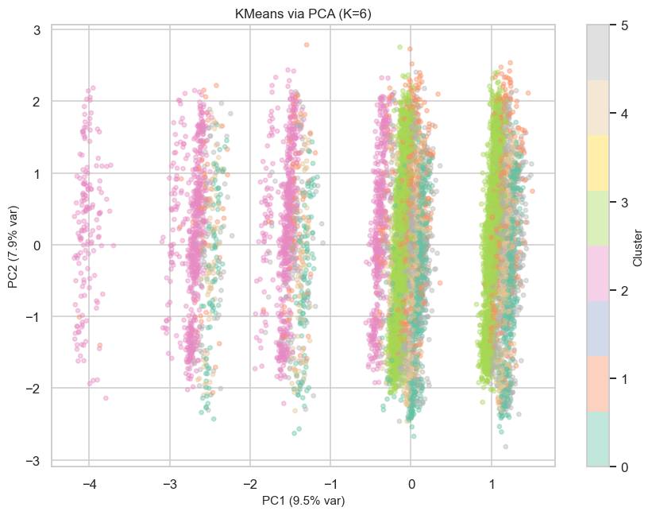

# Sheffield Road Collision — ML Analysis & Prediction

An end-to-end machine-learning pipeline on UK road-collision data (STATS19), filtered to Sheffield. One script takes the raw data through cleaning, exploratory analysis, feature engineering, and then classification, regression and clustering — saving every chart and result to `results/`.

Built for the **Artificial Intelligence & Machine Learning** module at Sheffield Hallam University (Level 5), where it achieved a First.

## What it does

The pipeline (`sheffield_collision_ml.py`) runs the whole thing in order:

1. **Data loading & Sheffield filter** — works out of the box on synthetic data, or on the real STATS19 dataset
2. **Exploratory data analysis** — distributions, correlations, overview plots
3. **Pre-processing & feature engineering**
4. **Classification** — three tasks: collision severity (Fatal/Serious/Slight), urban vs rural, and junction type
5. **Regression** — predicting number of vehicles and casualties, plus a collisions-per-year trend
6. **Clustering** — KMeans, DBSCAN and hierarchical, with elbow + silhouette to choose *k* and PCA for 2-D visualisation
7. **Model comparison** — side-by-side metrics, learning curves and feature importance

All output charts and result tables are in [`results/`](results/).

## Results

The charts below come straight from `results/`, produced by running the pipeline on its built-in synthetic dataset, which mirrors the real STATS19 columns and value ranges. Set `USE_REAL_DATA=True` to regenerate every chart from the real Sheffield records.



**Exploratory analysis:** severity split, collisions per year, month and hour, road surface, and missing values before cleaning.



**Model comparison:** nine classifiers on collision severity (left) and six on urban vs rural (right).



| What drives severity predictions | Clusters found by KMeans (PCA view) |
|---|---|
|  |  |

## Tech

Python · pandas · NumPy · scikit-learn · matplotlib · seaborn

## Run it

```bash
pip install -r requirements.txt
python sheffield_collision_ml.py
```

It runs immediately on synthetic data (`USE_REAL_DATA=False`). To use the real figures, download the dataset from the [UK road-safety open data](https://www.gov.uk/government/statistical-data-sets/road-safety-open-data), drop the CSV in `data/`, and set `USE_REAL_DATA=True`.
